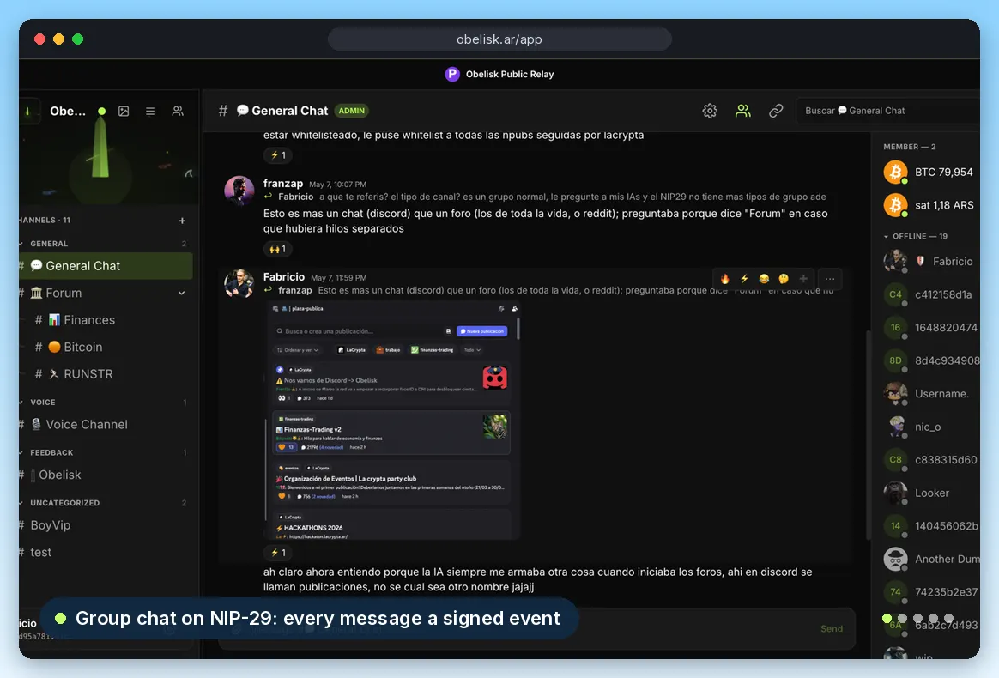
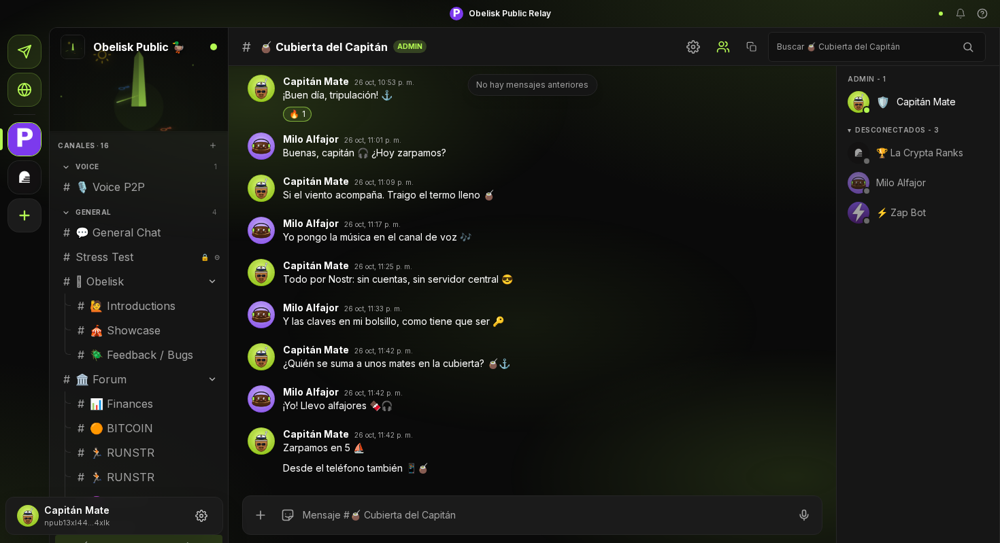
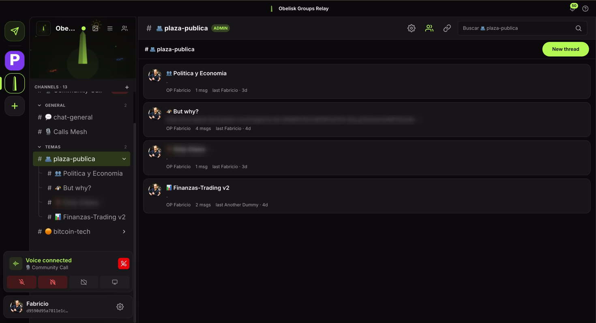
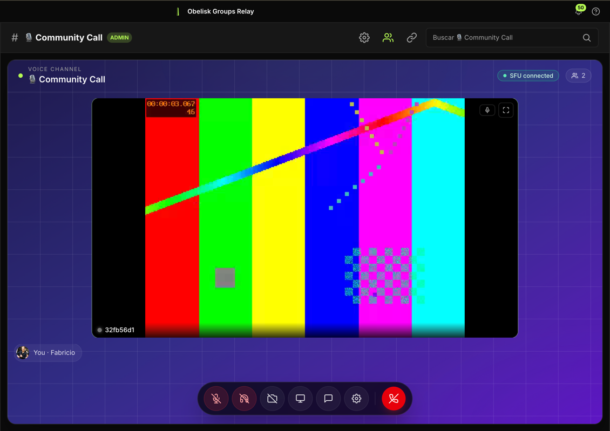
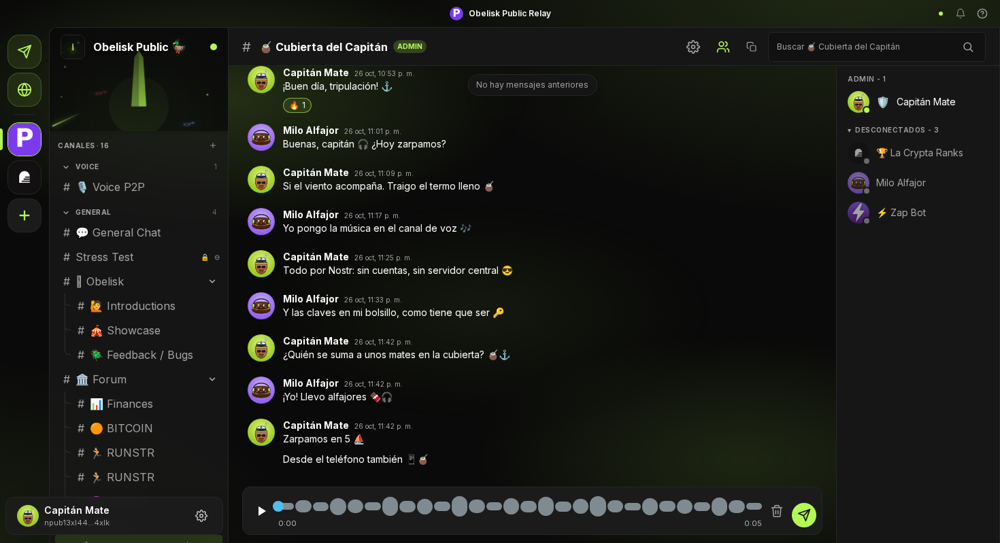
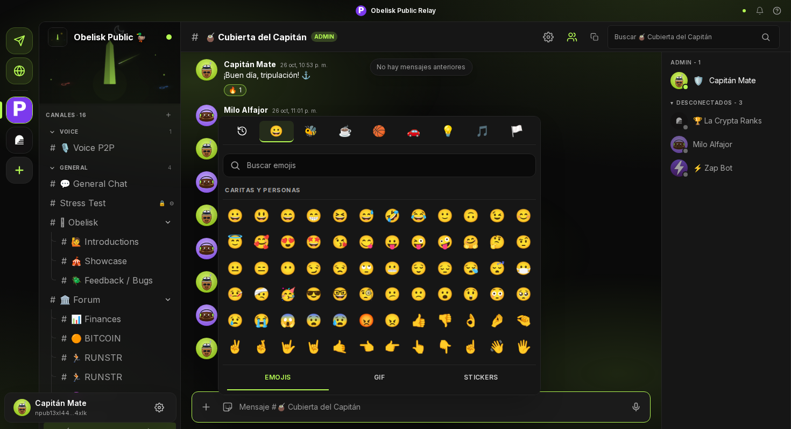
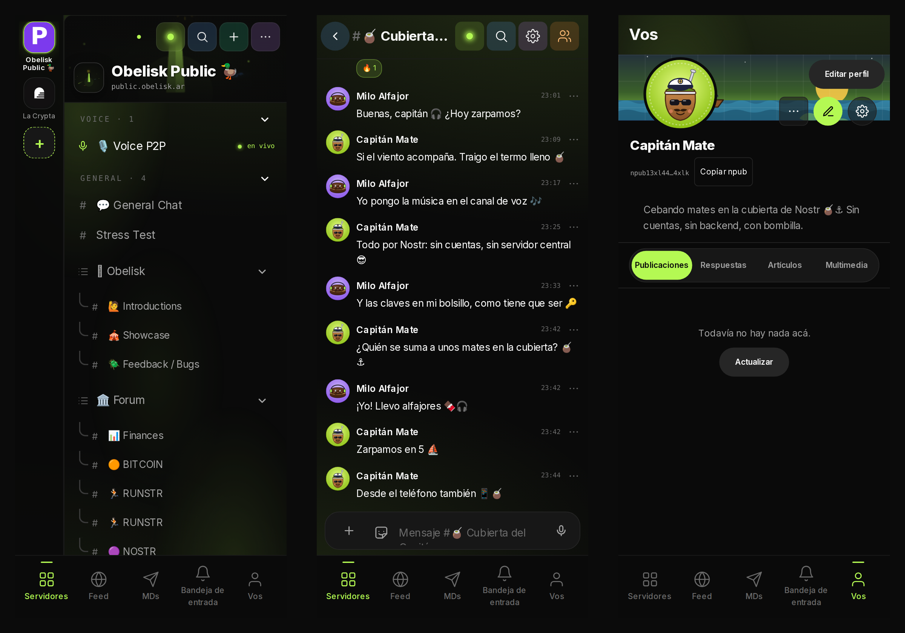
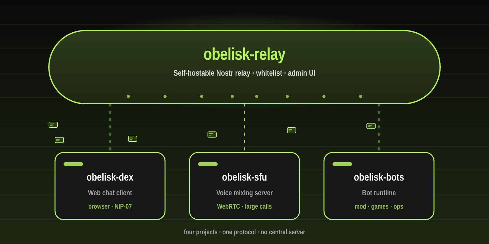

<div align="center">

<a href="https://obelisk.ar"></a>

<p>
  <a href="https://obelisk.ar"></a>
  <a href="https://github.com/obelisk-app/obelisk/stargazers"></a>
  <a href="https://github.com/obelisk-app/obelisk/commits/main"></a>
  <a href="https://github.com/obelisk-app/obelisk/graphs/commit-activity"></a>
  <a href="LICENSE"></a>
</p>
<p>
  
  
  
  
  
  
</p>

<h3>
  <a href="https://obelisk.ar">💬 Live app</a>
  &nbsp;·&nbsp;
  <a href="ROADMAP.md">🗺️ Roadmap</a>
  &nbsp;·&nbsp;
  <a href="docs/">📚 Docs</a>
  &nbsp;·&nbsp;
  <a href="#the-obelisk-family">🗿 Sibling repos</a>
</h3>

</div>

---

## What it is

A Next.js app whose browser side talks **directly to Nostr relays**. Channels, members, admins, messages, DMs, voice, zaps, all reconstructed from NIP-29 / NIP-17 / NIP-04 events. There is no Postgres, no session server, no Socket.io: just the browser, a relay, and your keys.

## Why

- 🔑 **No personal data.** Identity is a Nostr keypair. No email, phone, name, or device fingerprint.
- 🛰️ **No backend to trust.** Group state lives on relays you choose. Anyone can run one.
- 🌐 **Self-hostable.** `npm run build` + `npm start`, behind any reverse proxy.

## Demo
https://github.com/user-attachments/assets/4b6e31a9-a30d-43b3-b18a-dd21c1cf9c15

## Screenshots

Full guided tours: [obelisk.ar/desktop](https://obelisk.ar/desktop) · [obelisk.ar/mobile](https://obelisk.ar/mobile).

<p align="center">
  <a href="https://obelisk.ar"></a>
</p>

### Desktop

<details>
<summary><b>Full-size desktop screenshots</b></summary>
<br>

<p align="center">
  
</p>

<p align="center"><sub>A channel on the public relay: server rail, channel list, message stream with reactions, and the live NIP-29 member list. Every message is a signed Nostr event.</sub></p>

<p align="center">
  
</p>

<p align="center"><sub>Publication-kind channels become a tidy feed: a list of posts, OP and last-reply metadata, each with its own chat, same NIP-29 moderation as every other channel.</sub></p>

<p align="center">
  
</p>

<p align="center"><sub>Voice scales from a P2P mesh to a mediasoup SFU when the relay advertises one. Same UI: the mesh signals over Nostr with kind 25050 events; with an SFU the client signs a kind 22242 challenge on its RPC socket, then takes more peers and screen-share.</sub></p>

<table>
<tr>
<td width="50%"></td>
<td width="50%"></td>
</tr>
<tr>
<td align="center"><sub>Voice notes, recorded right in the composer.</sub></td>
<td align="center"><sub>Emoji, GIFs and stickers, one picker away.</sub></td>
</tr>
</table>

</details>

### Mobile

<p align="center">
  
</p>

<p align="center"><sub>Mobile-first server and channel list · a channel conversation · your portable Nostr profile.</sub></p>

## Try it

| | |
|---|---|
| **Live** | [obelisk.ar](https://obelisk.ar): the client, pointed at a public relay I operate |
| **La Crypta** | A community of 20+ migrated from Discord |
| **Self-host** | `git clone` + `npm run build` + `npm start`. Bring your own relay. |

## Run locally

```bash
git clone https://github.com/obelisk-app/obelisk.git
cd obelisk
npm install
npm run dev          # http://localhost:3000
```

No `.env` is required for local development. New installs currently start with `wss://public.obelisk.ar` and `wss://lacrypta-relay.obelisk.ar`; optional relay suggestions come from `NEXT_PUBLIC_RECOMMENDED_RELAYS`.

For HTTPS dev (needed for NIP-07 / mobile testing): `npm run dev:raise` (requires a Cloudflare tunnel, see [docs/operations/cloudflare-tunnel.md](docs/operations/cloudflare-tunnel.md)).

## Architecture

<p align="center">
  
</p>

<p align="center"><sub>The relay hosts the group. Members, admins, and messages are signed Nostr events; the client just subscribes.</sub></p>

- **Frontend:** Next.js 16 + Tailwind v4, in English, Spanish and Portuguese (next-intl). Public site pages are prerendered per deployment; chat and signed-in viewer interactions run over the bridge. Public relay-backed viewers also fetch server-rendered content. The one API route, `/api/link-preview`, unfurls OpenGraph cards so a link you only view never reaches a third-party service.
- **Relay hub** (`src/lib/relay-hub/`): the one owner of every relay socket: one socket per relay per identity, NIP-42 AUTH once per relay and key, shared subscriptions, bounded caches.
- **Bridge** (`src/services/nostr-bridge/`): identity, the session, group and DM state, subscriptions, and the React hooks, reached through `@/services/nostr-bridge` and `<BridgeProvider>`. Read this first if you're contributing.
- **Voice:** P2P mesh by default; switches to mediasoup SFU automatically when one is advertised on the channel ([obelisk-app/obelisk-sfu](https://github.com/obelisk-app/obelisk-sfu)).
- **Cache:** immutable public HTML with build-bound CSP hashes; dynamic app/viewer documents use fresh nonces. Browser relay data uses localStorage stale-while-revalidate for fast first paint.
- **Identity:** comes from the bridge: `useIsLoggedIn`, `useMyPubkey`, `useSignerReady`. **Don't introduce a backend session.**

See [architecture](docs/architecture/README.md), [UI conventions](docs/ui/conventions.md) and [operations](docs/operations/README.md). [AGENTS.md](AGENTS.md) is the repository rules reference.

## The Obelisk family

<p align="center">
  
</p>

<p align="center"><sub>Four small projects, one open protocol. Swap any of them out; the rest keep working.</sub></p>

| Repo | What |
|------|------|
| [**obelisk-app/obelisk**](https://github.com/obelisk-app/obelisk) | This repo: the chat app (relay-only) |
| [obelisk-app/obelisk-relay](https://github.com/obelisk-app/obelisk-relay) | NIP-29 groups relay (Rust, fork of `verse-pbc/groups_relay`) |
| [obelisk-app/obelisk-sfu](https://github.com/obelisk-app/obelisk-sfu) | mediasoup SFU for voice channels (Node, Nostr-RPC signaling) |
| [obelisk-app/obelisk-agents](https://github.com/obelisk-app/obelisk-agents) | Nostr bots for NIP-29 groups (price ticker, admin/welcome bots, agent-friendly CLI) |
| [obelisk-app/obelisk-sky](https://github.com/obelisk-app/obelisk-sky) | A 3D village that is an Obelisk client ([sky.obelisk.ar](https://sky.obelisk.ar)) |
| [obelisk-app/obelisk-apps](https://github.com/obelisk-app/obelisk-apps) | Games and apps published as Nostr events, run sandboxed by the client |
| [obelisk-app/obelisk-menhir](https://github.com/obelisk-app/obelisk-menhir) | Host a private chat server from your own computer, over Tor (MVP) |
| [obelisk-app/obelisk-design](https://github.com/obelisk-app/obelisk-design) | Design system, security workflows and development style |
| [obelisk-app/obelisk-classic](https://github.com/obelisk-app/obelisk-classic) | Retired July 28, 2026: the original Postgres + Socket.io stack |

## Auth

Three methods, all client-side:

| Method | How |
|---|---|
| NIP-07 extension | Click "Connect"; auto-detected (button hides if no extension) |
| nsec | Paste `nsec1...` |
| NIP-46 bunker | Paste a `bunker://` URL or scan a Nostr Connect QR |

The session record lives in `localStorage`, but its secrets (an nsec, a bunker URL) are sealed first with a non-extractable AES-GCM key kept in IndexedDB, so nothing secret is stored in the clear. NIP-42 AUTH is answered once per relay and key by the relay hub.

## Features

- Real-time chat (groups, channels, reactions, mentions, NIP-50 search)
- Voice channels (P2P mesh, optional SFU for larger rooms)
- Encrypted DMs (NIP-17 gift wraps by default, NIP-04 per thread on request; NIP-65 / kind 10050 relay routing) and 1:1 voice and video calls
- Bitcoin zaps in chat and paying invoices posted in chat (NIP-57 zaps, paid by a wallet connected with Nostr Wallet Connect in Settings > Wallet, else a WebLN browser extension; the connection link is sealed in the browser and no Obelisk server is in the payment path)
- Operator-controlled branding & layout (NIP-78, kind 30078)
- Image uploads (Blossom, BUD-01 auth)

## NIPs used

NIP-01 · NIP-04 · NIP-05 · NIP-07 · NIP-11 · NIP-17 · NIP-29 · NIP-42 · NIP-44 · NIP-46 · NIP-50 · NIP-57 · NIP-59 · NIP-65 · NIP-78

## Scripts

```bash
npm run dev               # dev server
npm run dev:raise         # dev + Cloudflare tunnel
npm run lint              # eslint
npm run typecheck         # tsc --noEmit
npm run test              # vitest
npm run build             # Next build + matching static CSP manifest
npm run raise             # production server + Cloudflare tunnel
npm run deploy            # production deploy (tests, build, pm2 restart)
```

## Contributing

Issues and PRs welcome.

1. `npm run lint`, `npm run typecheck` and `npm run test` must pass.
2. Follow the La Crypta design system (`lc-*` CSS classes, `lc-green` accent).
3. Identity comes from the bridge; don't introduce a new auth store or backend session.
4. New relay-derived data goes through the bridge (StateStore + ingest method + subscribeXxx + useXxx hook).

See [AGENTS.md](AGENTS.md) for the full guide.

## Star history

<p align="center">
<a href="https://star-history.com/#obelisk-app/obelisk&Date">
  <picture>
    <source media="(prefers-color-scheme: dark)" srcset="https://api.star-history.com/svg?repos=obelisk-app/obelisk&type=Date&theme=dark">
    
  </picture>
</a>
</p>

## Legal

Obelisk is free software under the **[AGPL-3.0](LICENSE)**. It is provided **as-is, without warranty
of any kind**, express or implied. See the licence for the full disclaimer of warranty and
limitation of liability.

This repository is software, not a service. Nostr relays are independent servers run by independent
operators. I operate `public.obelisk.ar` and `lacrypta-relay.obelisk.ar`; I do not operate or
control any other relay, and I cannot moderate, delete, or disclose anything on one.

- **Abuse, illegal content, takedowns:** [ABUSE.md](ABUSE.md), abuse@obelisk.ar
- **Security vulnerabilities:** [SECURITY.md](SECURITY.md), security@obelisk.ar

Obelisk is an individual open-source project. There is no company behind it.

## Resources

- Docs: [auth & data loading](docs/architecture/data-system.md) · [voice (mesh)](docs/features/voice/README.md) · [SFU](docs/features/sfu-system.md) · [layout & branding](docs/features/relay-layout-and-branding.md) · [uploads](docs/features/uploads.md) · [Cloudflare tunnel](docs/operations/cloudflare-tunnel.md) · [known bugs](docs/operations/known-bugs.md)
- External: [Nostr](https://nostr.com) · [NIPs](https://github.com/nostr-protocol/nips) · [La Crypta](https://lacrypta.ar)
